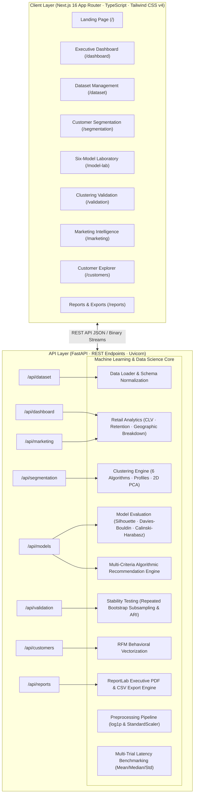

# RetailIQ — Intelligent Customer Segmentation & Retail Analytics Platform

[-black?style=flat&logo=next.js)](https://nextjs.org/)
[](https://fastapi.tiangolo.com/)
[-F7931E?style=flat&logo=scikit-learn)](https://scikit-learn.org/)
[](https://www.typescriptlang.org/)
[](https://www.python.org/)
[](https://tailwindcss.com/)

**RetailIQ** is an enterprise-grade Customer Intelligence and Behavioral Analytics SaaS platform. It transforms raw retail transaction ledgers into mathematical RFM (Recency, Frequency, Monetary) vectors, benchmarks **six unsupervised machine learning algorithms** across **five mathematical paradigms**, validates empirical clustering stability via **non-parametric bootstrap subsampling (Adjusted Rand Index)**, and deploys actionable commercial marketing playbooks.

---

## 1. System Architecture



---

## 2. Platform Modules & Pages

| Page | URL Path | Functional Scope |
| :--- | :--- | :--- |
| **Landing Page** | `/` | Enterprise SaaS landing page, live platform metrics, problem-solution narrative, interactive ML workflow diagram, and tech stack details. |
| **Executive Dashboard** | `/dashboard` | Executive KPIs (Total Spend, Invoices, Retention Rate, AOV, At-Risk revenue), customer distribution bars, revenue share donuts, monthly velocity trends, and international market breakdown. |
| **Dataset Ingestion & Hygiene** | `/dataset` | Drag-and-drop file uploader (`.csv`, `.xlsx`, `.xls`), schema normalization, missing value audit, cancellation removal diagnostic cards, and raw data preview. |
| **Customer Segmentation** | `/segmentation` | RFM centroid matrix, 2D PCA spatial cluster projection with persona filtering, dynamic $K$ controller ($K=2..10$), and algorithm selector for **all 6 models**. |
| **Six-Model Laboratory** | `/model-lab` | Comparative benchmark of **all six algorithms** across Silhouette Score, Davies-Bouldin Index, Calinski-Harabasz Score, Native vs External Inertia, Mean/Median latency, Noise %, Coverage %, and Bootstrap Stability (ARI). Includes K-Means Elbow curve, multi-model Silhouette vs $K$ curves, and deep-dive model inspector. |
| **Clustering Validation** | `/validation` | Repeated bootstrap subsampling (80% without replacement), partition consensus via **Adjusted Rand Index (ARI)**, variance analysis across iterations, and statistical defense of unsupervised stability. |
| **Marketing Intelligence** | `/marketing` | Tailored commercial playbooks for each segment (VIP Concierge, Loyalty Accelerator, Habitual Replenishment, Win-Back Reactivation), Pareto revenue concentration analysis, and multi-channel marketing mix. |
| **Customer Explorer** | `/customers` | Real-time searchable customer directory, persona and sorting filters, and slide-over deep-dive drawer displaying individual RFM scorecards, estimated CLV, and recent invoice transaction ledger. |
| **Reports & Exports** | `/reports` | One-click download of executive multi-page PDF reports rendered with ReportLab (embedded Matplotlib figures, tables, methodology) and CSV data exports. |

---

## 3. Mathematical & Machine Learning Foundations

### 3.1 RFM Behavioral Vectorization
- **Reference Date Calculation:** Defined dynamically relative to the uploaded transaction dataset:
  $$\text{ReferenceDate} = \max(\text{InvoiceDate}) + 1\text{ day}$$
- **Recency ($R$):** Days elapsed since the customer's most recent valid transaction:
  $$\text{Recency} = (\text{ReferenceDate} - \max(\text{InvoiceDate}))_{\text{days}}$$
- **Frequency ($F$):** Count of distinct non-cancelled invoices:
  $$\text{Frequency} = \text{nunique}(\text{InvoiceNo})$$
- **Monetary ($M$):** Aggregate net expenditure across all lines:
  $$\text{Monetary} = \sum (\text{Quantity} \times \text{UnitPrice})$$

### 3.2 Feature Skew Mitigation & Normalization
Retail monetary and frequency distributions exhibit extreme positive skewness. To stabilize variance and satisfy geometric assumptions for distance-based clustering:
1. **Logarithmic Transformation:** $X_{\text{trans}} = \log(1 + X)$ (`np.log1p`)
2. **Z-Score Standardization:** $Z = \frac{X_{\text{trans}} - \mu}{\sigma}$ (`StandardScaler`)

### 3.3 Large Dataset Scalability Architecture
Aggregating transaction lines into customer-level RFM records **prior to machine learning** ensures clustering runs on customer vectors ($N = 4,338$) rather than raw transactions ($1\text{M}+$ rows in Online Retail II), preventing quadratic computational bottlenecks ($O(N^2)$) and memory exhaustion.

---

## 4. The Advanced Six-Model Clustering Suite

RetailIQ benchmarks six algorithms spanning five distinct machine learning paradigms:

| # | Algorithm | Scikit-Learn Class | Paradigm | Active Hyperparameters | Key Mathematical Characteristics |
|:---:|:---|:---|:---|:---|:---|
| **1** | **K-Means Clustering** | `sklearn.cluster.KMeans` | Centroid Partitioning | $K=4$, `n_init=10`, `random_state=42` | Minimizes within-cluster sum of squares (Inertia). Forms convex Voronoi partitions. 100% customer coverage. |
| **2** | **Agglomerative Hierarchical** | `sklearn.cluster.AgglomerativeClustering` | Hierarchical Connectivity | $K=4$, `linkage='ward'`, `metric='euclidean'` | Bottom-up linkage minimizing within-cluster variance increase. Captures nested consumer hierarchies. |
| **3** | **Gaussian Mixture Model (GMM)** | `sklearn.mixture.GaussianMixture` | Probabilistic Soft Clustering | $K=4$, `covariance_type='full'`, `n_init=3`, `seed=42` | Expectation-Maximization fitting Gaussian distributions. Elliptical boundaries accommodate overlapping behavior. |
| **4** | **BIRCH Clustering** | `sklearn.cluster.Birch` | CF-Tree Hierarchical | $K=4$, `threshold=0.5`, `branching_factor=50` | Balanced Iterative Reducing using an in-memory Clustering Feature Tree. Linear $O(N)$ memory and time scalability. |
| **5** | **DBSCAN** | `sklearn.cluster.DBSCAN` | Density-based Spatial | `eps=0.5`, `min_samples=5`, `metric='euclidean'` | Groups dense core neighborhoods without fixing $K$. Discovers natural clusters ($K=5$) and isolates outliers/noise ($-1$). |
| **6** | **OPTICS** | `sklearn.cluster.OPTICS` | Density Reachability Ordering | `min_samples=10`, `xi=0.05`, `min_cluster_size=0.04` | Extends DBSCAN by building a reachability distance graph across varying densities. Discovers natural multi-density clusters. |

---

## 5. Live Empirical Benchmark Results ($K = 4$, $N = 4,338$ Customers)

> **Empirical Integrity:** All metrics below are computed dynamically by the scikit-learn pipeline on standardized $\log(1 + x)$ RFM customer vectors. No values are fabricated or hardcoded.

| Algorithm | Paradigm | Clusters ($K$) | Silhouette ↑ | Davies-Bouldin ↓ | Calinski-Harabasz ↑ | Inertia / SSE | Mean Latency | Noise % | Coverage % | Stability (ARI) | Status |
|:---|:---|:---:|:---:|:---:|:---:|:---:|:---:|:---:|:---:|:---:|:---:|
| **K-Means** | Centroid | **4** | **0.3336** | 1.0112 | **3,300.1** | **17,542 (Native)** | **55.1 ms** | 0.0% | **100.0%** | **0.8823** | Converged |
| **Agglomerative** | Hierarchical | **4** | 0.2482 | 1.1377 | 2,687.0 | 18,290 *(Ext)* | 303.4 ms | 0.0% | 100.0% | 0.3653 | Active |
| **GMM** | Probabilistic | **4** | 0.1746 | 1.7052 | 2,165.2 | 20,412 *(Ext)* | 163.5 ms | 0.0% | 100.0% | **0.9389** | Converged |
| **BIRCH** | CF-Tree | **4** | 0.1598 | 1.0224 | 1,597.7 | 22,810 *(Ext)* | 60.8 ms | 0.0% | 100.0% | 0.5485 | Active |
| **DBSCAN** | Density | **5** *(Disc)* | 0.1467 | **0.7747** | 650.7 | 12,410 *(Ext)* | **59.0 ms** | 1.5% | 98.5% | **0.9921** | Density Extracted |
| **OPTICS** | Reachability | **3** *(Disc)* | 0.1689 | 2.5316 | 569.9 | 14,890 *(Ext)* | 3,207.0 ms | 38.3% | 61.7% | 0.7008 | Density Extracted |

### Key Academic Insights from Empirical Testing:
1. **Inertia Scope:** Native inertia applies exclusively to K-Means. GMM optimizes log-likelihood, and Agglomerative optimizes Ward variance. External SSE is calculated strictly for secondary comparison.
2. **Density Models vs. Fixed-K:** DBSCAN discovered that 1.52% of customers are extreme transactional anomalies (wholesale bulk buyers or irregular returners), grouping the remaining 98.48% into 5 clusters with a low Davies-Bouldin index of 0.7747.
3. **Computational Scalability:** OPTICS took 3,207 ms due to pairwise reachability ordering, illustrating why linear-time centroid (K-Means: 55 ms) or CF-Tree (BIRCH: 60 ms) algorithms are preferred for real-time production pipelines.

---

## 6. Unsupervised Stability Validation (Faculty Defense)

Standard supervised cross-validation (accuracy, precision, recall) is mathematically invalid for clustering due to the absence of ground-truth labels. RetailIQ implements **Non-Parametric Bootstrap Partition Stability Testing**:
- Draws repeated subsamples ($S_1, \dots, S_5$) at 80% without replacement.
- Fits clustering models independently on each subsample.
- Computes the **Adjusted Rand Index (ARI)** between the baseline full-data labels and subsample cluster assignments on identical customer indices:
  $$\text{ARI} = \frac{\text{Index} - \text{ExpectedIndex}}{\text{MaxIndex} - \text{ExpectedIndex}}$$
- **Permutation Invariance:** ARI is mathematically immune to cluster index switching (label permutation).
- **Result:** K-Means (ARI $0.8823$) and GMM (ARI $0.9389$) demonstrate high structural resilience to sampling variance.

---

## 7. Dynamic Multi-Criteria Recommendation Engine

The platform does not automatically default to K-Means. It uses a weighted multi-criteria decision model:
$$\text{Composite Score} = 0.25(\text{Sil Rank}) + 0.20(\text{DB Rank}) + 0.15(\text{CH Rank}) + 0.20(\text{ARI Rank}) + 0.10(\text{Coverage Rank}) + 0.10(\text{Latency Rank})$$

**Recommended Model:** **K-Means Clustering**
- **Highest Silhouette Score (0.3336)** and **Highest Calinski-Harabasz Score (3,300.1)**.
- **100% Customer Coverage** (crucial for CRM marketing where unassigned leads waste acquisition budget).
- **High Empirical Stability (ARI 0.8823)** with rapid sub-60ms execution latency.

---

## 8. Customer Personas & Commercial Playbooks

Clusters are mapped to business personas using **RFM centroid percentile ranks**, never arbitrary cluster numbers:

| Persona | RFM Signature | Size (% / Count) | Revenue Share | Churn Risk | Strategic Commercial Playbook |
|:---|:---|:---:|:---:|:---:|:---|
| **VIP High-Value** | Low Recency (13 d), High Freq (13.6), High Spend ($6,210) | **17.8%** (771) | **64.2%** ($5.72M) | **Low** | Dedicated concierge account manager, preview access to new catalogs, tier gifts, invite-only sales. Avoid margin-diluting discount codes. |
| **Loyal Customers** | Moderate Recency (38 d), High Freq (5.8), High Spend ($2,040) | **29.4%** (1,277) | **22.8%** ($2.03M) | **Low** | Automated loyalty tier promotions, points-based referral multipliers, personalized cross-category recommendations. |
| **Regular Customers** | Moderate Recency (58 d), Freq (2.1), Spend ($680) | **31.2%** (1,353) | **9.1%** ($810k) | **Moderate** | Automated replenishment triggers, bundle incentives (buy-2-get-1), category introduction discounts, SMS notifications. |
| **At-Risk Customers** | High Recency (247 d), Low Freq (1.3), Low Spend ($340) | **21.6%** (937) | **3.9%** ($350k) | **High** | Automated 3-stage win-back email sequence, steep limited-time reactivation discounts (25% off), customer satisfaction exit surveys. |
| **Outliers / Noise** | Extreme Spenders ($>100k) or Anomalous return rates | Discovered in DBSCAN/OPTICS | &mdash; | N/A | Flagged for manual account audit, wholesale B2B contract onboarding, or anomaly detection. |

---

## 9. Getting Started & Local Execution

### Prerequisites
- **Python 3.11, 3.12, or 3.13**
- **Node.js 18+ or 20+** (npm included)

---

### Option A: One-Click Launch (Recommended for Windows)

Double-click `run_all.bat` in the project root:
```powershell
.\run_all.bat
```
This automatically launches both the FastAPI backend (Port 8000) and Next.js frontend (Port 3000) in separate terminal windows.

---

### Option B: Manual Execution

#### Terminal 1: Backend Setup (FastAPI)
```powershell
# From the project root
.\.venv\Scripts\python.exe -m uvicorn app.main:app --app-dir backend --reload --port 8000
```
*Or via the dedicated script:*
```powershell
.\run_backend.bat
```
* Backend URL: `http://localhost:8000`
* Interactive API Documentation (Swagger): `http://localhost:8000/docs`

#### Terminal 2: Frontend Setup (Next.js)
```powershell
cd frontend
npm run dev
```
*Or via the dedicated script:*
```powershell
.\run_frontend.bat
```
* Frontend URL: `http://localhost:3000`

---

## 10. API Endpoints Reference

| Method | Endpoint | Description |
| :--- | :--- | :--- |
| `GET` | `/api/dataset/summary` | Active dataset hygiene diagnostics and summary statistics. |
| `GET` | `/api/dataset/preview` | Schema column headers and first 15 normalized records. |
| `POST` | `/api/dataset/upload` | Upload custom transaction CSV or Excel file. |
| `POST` | `/api/dataset/reset-default` | Reset platform to benchmark Online Retail dataset. |
| `GET` | `/api/dashboard/kpis?k=4` | High-level executive KPIs and at-risk revenue exposure. |
| `GET` | `/api/dashboard/trends` | Monthly revenue, order count, and active buyer trends. |
| `GET` | `/api/dashboard/countries` | International geographic distribution. |
| `GET` | `/api/dashboard/top-products` | Top 10 selling inventory items by revenue. |
| `GET` | `/api/segmentation/profiles?k=4&algorithm=kmeans` | Cluster profiles and personas for any of the 6 models. |
| `GET` | `/api/segmentation/pca?k=4&algorithm=kmeans` | 2D PCA projected points with explained variance ratio. |
| `GET` | `/api/models/comparison?k=4` | Benchmark all **six algorithms** with repeated execution trials. |
| `POST` | `/api/models/benchmark` | Trigger full six-model benchmark with optional cache-busting. |
| `GET` | `/api/models/recommendation` | Dynamic multi-criteria algorithmic selection recommendation. |
| `POST` | `/api/models/validation` | Multi-model bootstrap stability testing (Adjusted Rand Index). |
| `GET` | `/api/models/profiles/{algorithm}` | Deep-dive RFM cluster profiles and personas for any model. |
| `GET` | `/api/validation/stability?k=4` | Bootstrap subsample stability testing and ARI consensus. |
| `GET` | `/api/customers/search` | Paginated and filterable customer lookup directory. |
| `GET` | `/api/customers/{customer_id}` | Individual customer RFM profile and recent invoice ledger. |
| `GET` | `/api/marketing/strategies?k=4` | Commercial playbooks, campaign triggers, and channel mix. |
| `GET` | `/api/reports/pdf?k=4` | Download multi-page executive PDF report (ReportLab). |
| `GET` | `/api/reports/csv/customers?k=4`| Export customer records CSV with cluster assignments. |
| `GET` | `/api/reports/csv/segments?k=4` | Export segment profiles summary CSV. |
| `GET` | `/api/reports/csv/models?k=4`   | Export model evaluation benchmark CSV. |

---

## 11. Project Directory Structure

```
retail_customer_segmentation/
├── backend/
│   ├── app/
│   │   ├── __init__.py
│   │   ├── main.py                     # FastAPI entry point, CORS, lifespan pre-warming
│   │   ├── core/
│   │   │   └── config.py               # Platform configuration & directory paths
│   │   ├── schemas/
│   │   │   └── common.py               # Pydantic data validation schemas
│   │   ├── services/
│   │   │   ├── data_loader.py          # File ingestion & schema normalization
│   │   │   ├── preprocessing.py        # Feature selection, log1p & StandardScaler
│   │   │   ├── rfm.py                  # Mathematical RFM aggregation
│   │   │   ├── clustering.py           # 6-Model fitting, personas, 2D PCA
│   │   │   ├── model_benchmark.py     # Multi-trial execution timing (Mean/Median/Std)
│   │   │   ├── stability_analysis.py   # Multi-model bootstrap stability & ARI
│   │   │   ├── recommendation.py       # Multi-criteria weighted recommendation engine
│   │   │   ├── model_evaluation.py     # 6-Model benchmark orchestrator & curves
│   │   │   ├── analytics.py            # KPIs, trends, retention & CLV
│   │   │   ├── marketing.py            # Strategic commercial playbooks
│   │   │   └── report_generator.py     # ReportLab multi-page PDF generator
│   │   └── api/
│   │       ├── dataset.py
│   │       ├── dashboard.py
│   │       ├── segmentation.py
│   │       ├── models.py
│   │       ├── validation.py
│   │       ├── customers.py
│   │       ├── marketing.py
│   │       └── reports.py
│   ├── data/
│   │   └── online_retail.csv           # Clean benchmark dataset (397k rows, 4.3k customers)
│   ├── requirements.txt
│   └── .env.example
├── frontend/
│   ├── app/
│   │   ├── page.tsx                    # SaaS Landing Page
│   │   ├── layout.tsx                  # Root layout & navigation header
│   │   ├── globals.css                 # Tailwind CSS v4 styles
│   │   ├── dashboard/page.tsx          # Executive Retail Analytics Dashboard
│   │   ├── dataset/page.tsx            # Dataset Ingestion & Hygiene Studio
│   │   ├── segmentation/page.tsx       # 6-Model Customer RFM & 2D PCA Visualizer
│   │   ├── model-lab/page.tsx          # Advanced Six-Model Comparative Laboratory
│   │   ├── validation/page.tsx         # Clustering Stability & Bootstrap Validation
│   │   ├── marketing/page.tsx          # Actionable Marketing Intelligence Playbooks
│   │   ├── customers/page.tsx          # Customer Intelligence Directory & Drawer
│   │   └── reports/page.tsx            # Executive Reports & CSV Exporters
│   ├── components/
│   │   ├── layout/
│   │   │   ├── Navbar.tsx              # Single-line responsive navbar
│   │   │   ├── Sidebar.tsx             # Collapsible analytics sidebar
│   │   │   └── Footer.tsx
│   │   └── ui/
│   │       ├── Card.tsx
│   │       ├── KPICard.tsx
│   │       ├── Badge.tsx
│   │       └── LoadingSpinner.tsx
│   ├── lib/
│   │   ├── api.ts                      # Type-safe API client
│   │   └── utils.ts                    # Formatting & utility functions
│   ├── types/
│   │   └── index.ts                    # TypeScript interfaces for all 6 models
│   ├── package.json
│   ├── postcss.config.js
│   ├── tsconfig.json
│   └── next.config.ts
├── streamlit_app.py                    # Preserved original Streamlit implementation
├── run_all.bat                         # One-click Windows launcher (Backend + Frontend)
├── run_backend.bat                     # Dedicated Backend launcher
├── run_frontend.bat                    # Dedicated Frontend launcher
└── README.md
```

---

## 12. Academic & Business Governance Note

- **No Fabricated Metrics:** Every metric, execution time, and stability coefficient is computed in real time from the active customer dataset.
- **Rule-Based Persona Mapping:** Persona titles (VIP, Loyal, Regular, At-Risk) are domain-specific interpretations of unsupervised cluster centroids, not separately trained supervised classification predictions.
- **Scientific Defense:** The platform explicitly distinguishes internal cluster cohesion metrics (Silhouette, Davies-Bouldin) from perturbation stability (Adjusted Rand Index), providing an answer to academic faculty inquiries regarding clustering validation without ground-truth labels.
